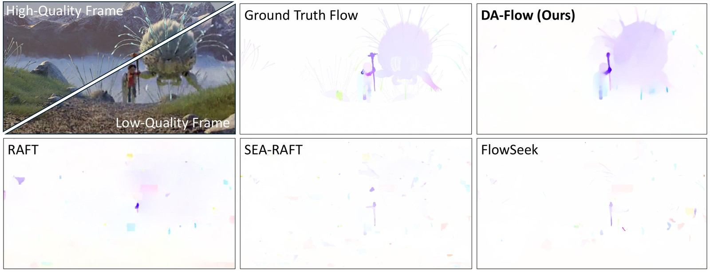

<p align="center">
  <h1 align="center">DA-Flow: Degradation-Aware Optical Flow Estimation with Image Restoration Diffusion Features</h1>

  <p align="center">
    <a href="https://min-jaewon.github.io/">Jaewon&nbsp;Min<sup>1</sup></a> ·
    <a href="#">Jaeeun&nbsp;Lee<sup>1</sup></a> ·
    <a href="#">Yeji&nbsp;Choi<sup>1</sup></a> ·
    <a href="#">Paul&nbsp;Hyunbin&nbsp;Cho<sup>1</sup></a> ·
    <a href="#">Jin&nbsp;Hyeon&nbsp;Kim<sup>1</sup></a> ·
    <a href="#">Tae-Young&nbsp;Lee<sup>2</sup></a> ·
    <a href="#">Jongsik&nbsp;Ahn<sup>2</sup></a> ·
    <a href="#">Hwayeong&nbsp;Lee<sup>2</sup></a> ·
    <a href="#">Seonghyun&nbsp;Park<sup>2</sup></a> ·
    <a href="https://cvlab.kaist.ac.kr/">Seungryong&nbsp;Kim<sup>1&dagger;</sup></a>
  </p>

  <p align="center">
    <sup>1</sup> KAIST&nbsp;AI ·
    <sup>2</sup> Hanwha&nbsp;Systems
  </p>

  <p align="center" style="font-size: 0.9em; color: gray;">
    <sup>&dagger;</sup> Corresponding&nbsp;author
  </p>

  <h3 align="center">
    <a href="https://arxiv.org/abs/2603.23499">Paper</a> |
    <a href="https://cvlab-kaist.github.io/DA-Flow">Project Page</a>
  </h3>
</p>

<p align="center">
  
</p>

## News
- **26.11.20** Code and pretrained weights are released.

## Installation

```bash
git clone https://github.com/cvlab-kaist/DA-Flow.git
cd DA-Flow
conda create -n daflow python=3.9 -y
conda activate daflow
pip install torch==2.6.0 torchvision==0.21.0 --index-url https://download.pytorch.org/whl/cu124
pip install -r requirements.txt
```

## Pretrained Weights

Accept the license of [Stable Diffusion 3.5 Medium](https://huggingface.co/stabilityai/stable-diffusion-3.5-medium) on its model page and log in with `huggingface-cli login`, then run:

```bash
bash scripts/download_weights.sh           # inference
bash scripts/download_weights.sh --train   # inference + training
```

| Path | Source | Used for |
|---|---|---|
| `checkpoints/DA-Flow/` | [DA-Flow](https://huggingface.co/Min-Jaewon/DA-Flow) | inference |
| `preset/models/stable-diffusion-3.5-medium/` | [SD3.5 Medium](https://huggingface.co/stabilityai/stable-diffusion-3.5-medium) (VAE, scheduler; text encoders with `--train`) | inference, training |
| `preset/models/dit4sr_q/` | [DiT4SR-Q](https://huggingface.co/acceptee/DiT4SR) | stage 1 |
| `preset/models/raft-things.pth` | [RAFT](https://github.com/princeton-vl/RAFT) | stage 2 |
| `preset/models/sea_raft/model.safetensors` | [SEA-RAFT](https://huggingface.co/MemorySlices/Tartan-C-T-TSKH-spring540x960-M) | stage 2 |

`preset/NULL_prompt_embeds.pt` and `preset/NULL_pooled_prompt_embeds.pt` (included in this repository) are the SD3.5 text embeddings of the empty prompt, used in stage 2 and inference. They can be regenerated with `python tools/compute_null_embeds.py` (requires the text encoders from `--train`).

## Inference

```bash
python inference.py --input path/to/video.mp4 --output results/demo --save_vis
```

`--input` can be a video, a folder of frames, or a folder containing multiple videos.

## Data Preparation

### Training data

Download [YouHQ](https://github.com/sczhou/Upscale-A-Video), caption the clips with LLaVA-v1.5-13B (stage-1 text prompts), and extract HQ / degraded LQ frames:

```bash
python tools/caption_youhq.py --root /path/to/YouHQ-Train --output data/YouHQ-captions
python data_preparation/prepare_youhq.py --root /path/to/YouHQ-Train --prompt_root data/YouHQ-captions --output_root data/YouHQ
```

### Evaluation data

```bash
python data_preparation/prepare_benchmarks.py sintel    --root /path/to/MPI-Sintel --output_root data/eval/Sintel
python data_preparation/prepare_benchmarks.py spring    --root /path/to/Spring     --output_root data/eval/Spring
python data_preparation/prepare_benchmarks.py tartanair --root /path/to/TartanAir  --output_root data/eval/TartanAir

for D in Sintel Spring TartanAir; do
  python data_preparation/degrade_videos.py --input_dir data/eval/$D/gt_videos --output_dir data/eval/$D/lq_videos/general
done
```

## Training

```bash
# Stage 1
bash scripts/train_stage1.sh

# Stage 2
STAGE1_CKPT=experiments/stage1_lifting/checkpoint-20000 bash scripts/train_stage2.sh
```

## Evaluation

```bash
bash scripts/eval_benchmark.sh Sintel
bash scripts/eval_benchmark.sh Spring
bash scripts/eval_benchmark.sh TartanAir
```

## Citation

```bibtex
@article{min2026daflow,
  title   = {DA-Flow: Degradation-Aware Optical Flow Estimation with Image Restoration Diffusion Features},
  author  = {Min, Jaewon and Lee, Jaeeun and Choi, Yeji and Cho, Paul Hyunbin and Kim, Jin Hyeon and Lee, Tae-Young and Ahn, Jongsik and Lee, Hwayeong and Park, Seonghyun and Kim, Seungryong},
  journal = {arXiv preprint arXiv:2603.23499},
  year    = {2026}
}
```

## Acknowledgements

This code is built upon [DiT4SR](https://github.com/adam-duan/DiT4SR), [RAFT](https://github.com/princeton-vl/RAFT), [SEA-RAFT](https://github.com/princeton-vl/SEA-RAFT), and [Upscale-A-Video](https://github.com/sczhou/Upscale-A-Video). We thank the authors for sharing their code.
